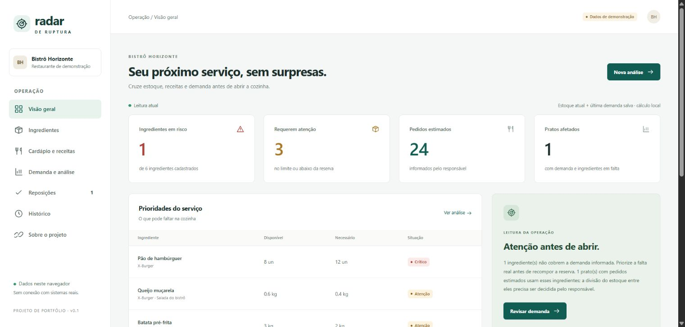
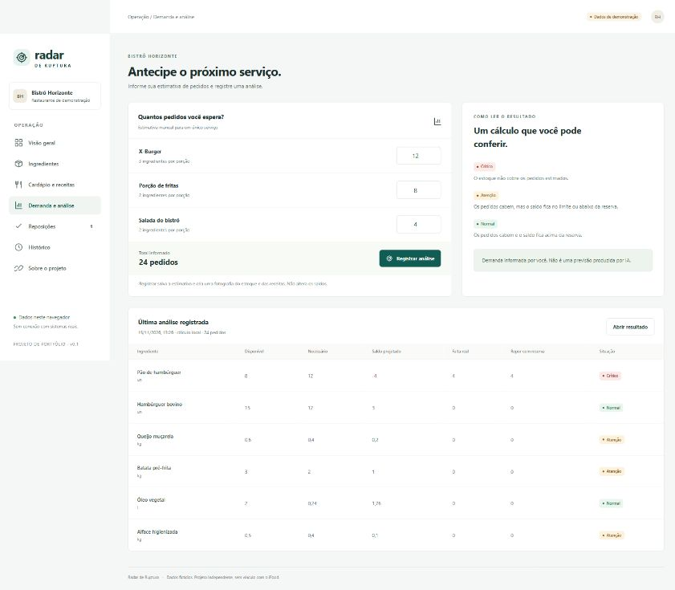
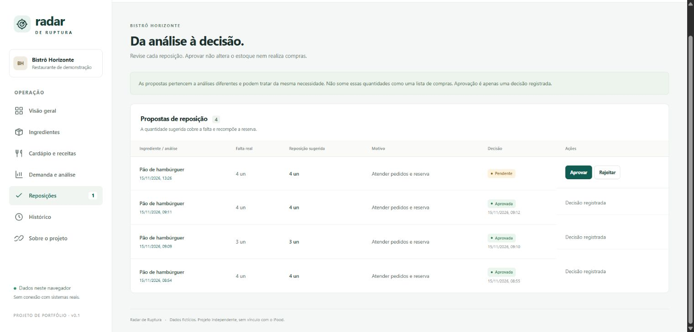
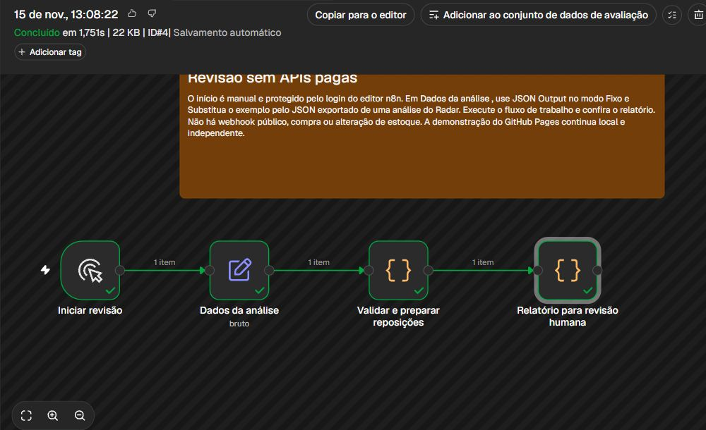
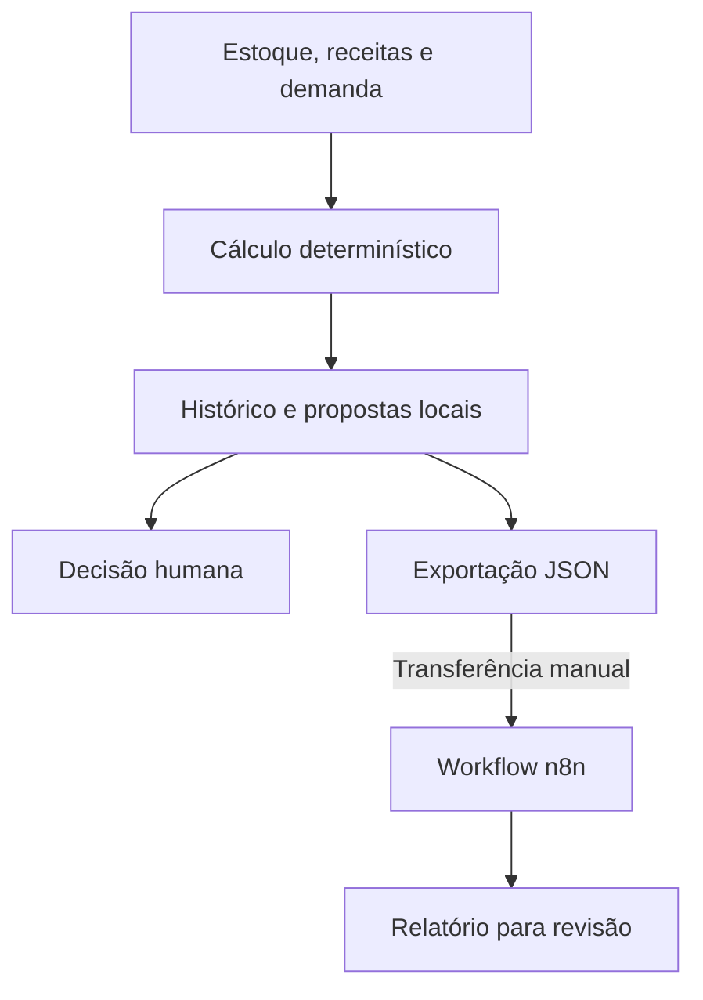

# Radar de Ruptura

Sistema web para antecipar a falta de ingredientes a partir do estoque, das receitas e da demanda estimada, com propostas de reposição e revisão humana.

**[Experimentar a demonstração →](https://augustopavan-dev.github.io/radar-de-ruptura/)**

JavaScript nativo · n8n · GitHub Pages · 36 testes aprovados



*Interface real da demonstração, com dados fictícios do Bistrô Horizonte.*

## O problema

Ter saldo de cada ingrediente não garante que o restaurante consiga atender o cardápio previsto. Um ingrediente compartilhado pode limitar vários pratos, e olhar cada receita separadamente pode contar o mesmo estoque mais de uma vez.

O Radar soma o consumo de todas as receitas para a demanda informada, distingue falta real de reserva de segurança e deixa a decisão de reposição com o responsável. É um projeto de portfólio, sem uso produtivo ou impacto comercial medido.

## A solução em poucos passos

1. Cadastre ingredientes e o consumo por porção nas receitas.
2. Informe a estimativa de pedidos do serviço.
3. Registre uma análise para conferir falta, risco e reposição sugerida.
4. Revise as propostas; aprove ou rejeite sem movimentar estoque.
5. Consulte a fotografia histórica ou exporte uma análise para o workflow n8n.

**Escopo:** os cálculos e as explicações são determinísticos. O n8n foi executado de verdade, mas recebe o JSON por transferência manual. Não há IA generativa, webhook ou previsão automática de vendas.

[Verificações](docs/VERIFICACAO.md) · [Guia n8n](docs/INTEGRACAO_N8N.md) · [Segurança](SECURITY.md) · [Apresentação do projeto](docs/APRESENTACAO.md)

## Funcionalidades

- Ingredientes com saldo, unidade e reserva de segurança.
- Receitas com consumo por porção e ingredientes compartilhados.
- Demanda estimada informada pela pessoa usuária.
- Falta real, saldo projetado, risco e reposição para recompor a reserva.
- Propostas com aprovação ou rejeição humana, sem compras ou alteração de estoque.
- Histórico com fotografia dos dados usados na análise.
- Exportação completa para consulta e exportação de uma análise para n8n.
- Persistência local e detecção de revisões desatualizadas entre abas.

As explicações usam regras determinísticas. Não há IA generativa ou previsão estatística de vendas.

## Exemplo: faltam 4 pães

| Ingrediente | Disponível | Por X-Burger | Pedidos | Necessário | Falta |
| --- | --- | --- | --- | --- | --- |
| Pão | 8 un | 1 un | 12 | 12 un | **4 un** |
| Carne | 15 un | 1 un | 12 | 12 un | 0 un |

Com reserva zero, pão é crítico, carne é normal e a capacidade isolada é 8 X-Burgers. O exemplo visual inclui queijo e outros pratos.

```text
necessário = soma(consumo por prato × pedidos)
saldo projetado = estoque - necessário
falta real = máximo(0, necessário - estoque)
reposição = máximo(0, necessário + reserva - estoque)
```

Saldo negativo é crítico; de zero até a reserva, inclusive, é atenção; acima da reserva é normal. Não se cria proposta de quantidade zero. Demanda zero pode gerar reposição se a reserva estiver insuficiente.

Kg e L aceitam até três casas decimais; unidades e pedidos exigem inteiros. O cálculo usa milésimos inteiros. A receita deve usar a unidade do ingrediente, sem conversão automática. Capacidades são isoladas e não podem ser somadas quando há ingredientes compartilhados.



*Análise registrada: 12 X-Burgers exigem 12 pães; o saldo disponível é 8.*



*Cada proposta pertence a uma análise. Aprovar registra uma decisão; não compra nem altera estoque.*

## Automação com n8n

O workflow recebe a fotografia de uma análise exportada, valida os dados, recalcula a necessidade e prepara um relatório com propostas pendentes, priorizando a falta real antes da reserva. Usa as mesmas fontes de cálculo do aplicativo.



*Captura real de uma execução bem-sucedida. Os quatro nós usam gatilho manual, Edit Fields e Code; não há API paga.*

O envio é manual pelo editor autenticado: exportar JSON → colar em **Dados da análise** → executar → revisar a saída. O resultado não retorna automaticamente ao Radar. O workflow é [importável](automations/radar-n8n-workflow.json); o [guia](docs/INTEGRACAO_N8N.md) detalha uso, contrato e plano de integração futura.

## Tecnologias e arquitetura

| Tecnologia | Uso |
| --- | --- |
| JavaScript com módulos nativos | Interface, regras e validação |
| HTML e CSS | Estrutura semântica e layout responsivo |
| LocalStorage | Cadastros, análises e decisões no navegador |
| Node.js e node:test | Servidor local, build e testes sem dependências |
| n8n Cloud | Validação e revisão operacional após envio manual |
| GitHub Pages | Hospedagem estática da demonstração |



O navegador executa as regras e salva fotografias históricas. O Pages entrega os arquivos; não processa dados no servidor. O n8n recalcula o pacote recebido e produz outro relatório, sem escrever no aplicativo. Uma conexão automática exigiria backend autenticado para proteger credenciais.

## Testes e validação

**36 testes aprovados, sem falhas**, no relatório [registrado](docs/testes-executados.txt). A cobertura inclui precisão decimal, consumo compartilhado, reservas, referências inválidas, persistência, conflitos entre abas e contrato da automação.

O autor confirmou manualmente a falta de 4 pães, a aprovação sem alterar estoque e o histórico após atualizar. No n8n Cloud foram verificados sucesso, estoque suficiente e rejeição de estoque negativo. Os testes do adaptador futuro usam dublês locais e não representam integração HTTP.

Consulte a [matriz de evidências e limites](docs/VERIFICACAO.md). As capturas acima foram feitas na aplicação publicada; não são protótipos.

## Executar localmente

Requer Node.js 22 ou superior e Git. No terminal:

```text
git clone https://github.com/augustopavan-dev/radar-de-ruptura.git
cd radar-de-ruptura
```

Não há dependências para instalar. Inicie com:

```text
node server.mjs
```

Abra o endereço mostrado no terminal. Também é possível abrir `Radar_de_Ruptura.html`; o armazenamento de arquivos locais depende das regras do navegador.

```text
node build-standalone.mjs
node build-automation.mjs
node --test tests/core.test.mjs tests/automation.test.mjs tests/standalone.test.mjs
```

O build gera `docs/index.html`, o HTML independente e o workflow com as mesmas regras das fontes. Não edite os arquivos gerados manualmente. Pages publica a branch `main`, pasta `/docs`.

| Arquivo | Responsabilidade |
| --- | --- |
| `src/engine.mjs` | Cálculo, unidades e validação |
| `src/model.mjs` | Fotografias históricas e decisões |
| `src/storage.mjs` | Persistência e revisão entre abas |
| `src/automation.mjs` | Pacote mínimo, validação e processamento |
| `src/app.mjs` | Interface e exportação |
| `src/integrations.mjs` | Adaptador futuro e fallback, testado com dublês |
| `automations/radar-n8n-workflow.json` | Workflow importável sem credenciais |
| `automations/example-analysis.json` | Entrada fictícia de exemplo |
| `docs/testes-executados.txt` | Resultado bruto dos testes |

## Limites e continuidade

Dados ficam no navegador, sem autenticação no aplicativo, banco remoto, sincronização ou integração com estoque real. Limpar dados do site pode apagar o histórico; exporte antes. A exportação completa é uma cópia de consulta; importação ainda não existe.

Aprovar não compra, recebe material ou altera estoque. Propostas de análises diferentes podem repetir a mesma necessidade. Não há fornecedores, custos, validade, lotes, prazos ou otimização da alocação entre pratos.

O período de avaliação do n8n Cloud não é um plano gratuito permanente. O workflow exportado permite continuidade em uma instalação própria; hospedagem própria pode ter custos e não foi instalada neste trabalho. Nenhuma assinatura ou API paga foi contratada.

A integração automática permanece uma etapa futura: exige backend autenticado e proteção de segredos. O [plano](docs/INTEGRACAO_N8N.md) define essa arquitetura e seus critérios de aceite.

## Próximas melhorias

- Importação de backup com validação e confirmação de substituição.
- Testes de interface automatizados e ampliação da avaliação de acessibilidade.
- Backend autenticado para integração automática com n8n.
- Validação do problema e do fluxo com pessoas que operam restaurantes.

São etapas planejadas, sem prazo ou resultado prometido.

## Autoria e contexto do portfólio

Projeto independente de **Augusto Pavan Ribeiro**, preparado como material de portfólio para a candidatura a AI Builder — Programa GenAI 2027 do iFood, sem vínculo ou endosso da empresa. Bistrô Horizonte e seus dados são fictícios.

Augusto forneceu o contexto, os requisitos e realizou os testes manuais informados na documentação. Implementação, correções e testes foram produzidos com assistência de IA. Não foram medidos resultados em restaurantes reais nem estimadas economias sem evidência.
